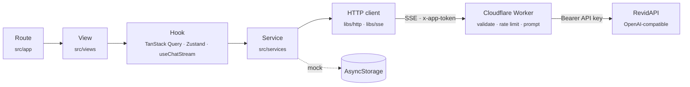

<div align="center">

# 🐾 PetPal

**Ứng dụng chăm sóc thú cưng với trợ lý AI "Pal" — tư vấn cá nhân hóa theo hồ sơ từng bé, trả lời dạng streaming, đặt lịch spa/khám/tiêm phòng trong vài chạm.**


</div>

---

## Demo

> 📸 Ảnh chụp màn hình / video demo sẽ được bổ sung.

| Thú cưng | Hỏi AI | Lịch hẹn |
|---|---|---|
| _(ảnh)_ | _(ảnh / gif streaming)_ | _(ảnh)_ |

---

## Tính năng

- **Onboarding** 3 slide, chỉ hiện ở lần mở đầu tiên.
- **Hồ sơ thú cưng**: thêm / sửa / xóa; loài, giống, tuổi, cân nặng, tính cách; chuyển nhanh giữa các bé.
- **Đa ngôn ngữ** 🇻🇳 Tiếng Việt · 🇺🇸 English · 🇰🇷 한국어: đổi ngay trong app (nút 🌐 hoặc ở onboarding), không cần tải lại; AI trả lời theo ngôn ngữ người dùng.
- **Hỏi AI (Pal)**: trả lời cá nhân hóa theo hồ sơ, hiện chữ dần (streaming), nút **Dừng**, gợi ý câu hỏi theo từng bé, lịch sử chat riêng cho mỗi bé.
- **Không bao giờ treo**: mất mạng, AI quá tải hay hết credit → tự chuyển **chế độ offline** với câu trả lời có sẵn và nút **Thử lại**.
- **Lịch hẹn**: chọn dịch vụ (giá VND) → ngày → giờ (giờ đã kín bị khóa) → xác nhận → animation thành công; **vuốt để hủy**.
- **Trải nghiệm**: skeleton thay spinner, empty state có hướng dẫn, pull-to-refresh, haptic, nhấn card có hiệu ứng, safe area đúng trên iPhone tai thỏ và Android, label cho trình đọc màn hình.
- Chạy trực tiếp trên **Expo Go** (iOS + Android), không cần build native.

---

## Kiến trúc

Kiến trúc **feature-based** áp dụng lại từ một dự án quản lý nhà hàng thực tế mình đã làm bằng **Next.js**, chuyển sang mobile. Mỗi domain (`pet`, `chat`, `appointment`) đi đủ các tầng **type → service → hook → view → components → route**, và mỗi tầng chỉ biết tầng ngay dưới nó.



| Tầng | Vai trò | Tương ứng bên web (Next.js) |
|---|---|---|
| `app/` | Chỉ khai báo route, render view | `app/` / `pages/` |
| `views/` | Ghép hook + component, **không** gọi service | Page container |
| `hooks/services/` | `useQuery` / `useMutation`, query key, optimistic | Lớp React Query |
| `services/` | `getAll / getById / create / update / delete` — hiện là mock AsyncStorage | API service |
| `libs/http.ts` | Base URL + header từ env, timeout, chuẩn hóa lỗi thành `AppError { code }` | axios instance + interceptor |

Đổi từ mock sang API thật chỉ cần sửa thân hàm trong `services/` — hook và view giữ nguyên.

<details>
<summary><b>Cây thư mục <code>src/</code> (rút gọn)</b></summary>

```
src/
├── app/                      # Expo Router — mỗi file chỉ render view
│   ├── _layout.tsx           # Providers + ErrorBoundary + Stack.Protected (onboarding)
│   ├── onboarding.tsx
│   ├── (tabs)/               # index (Thú cưng) · chat (Hỏi AI) · appointment (Lịch hẹn)
│   ├── pet/[id].tsx · pet/new.tsx (modal)
│   └── appointment/book.tsx (modal)
├── views/                    # pet · chat · appointment · onboarding
├── components/
│   ├── ui/                   # Button, Card, Pill, Chip, Avatar, Skeleton, EmptyState, ErrorState, Screen…
│   ├── pet/                  # PetCard, PetSelector, PetFormFields, DialogDeletePet
│   ├── chat/                 # ChatBubble, ChatInput, StreamingBubble, TypingIndicator, SuggestionChips
│   ├── appointment/          # DateStrip, TimeSlotGrid, ServiceCard, AppointmentListItem, SuccessCheck
│   └── common/               # DialogConfirm
├── hooks/
│   ├── services/             # usePets, useCreatePet…, useAppointments, useBookAppointment…, queryKeys
│   └── useChatStream · useHaptic · useAppState · useSelectedPet
├── services/                 # pet · appointment (mock) · ai (stream, abort, timeout, fallback)
├── libs/                     # http · sse · queryClient · storage
├── store/                    # Zustand: CHỈ UI state
├── types/services-type/      # <domain>.type.ts + common.type.ts
└── theme/ · constants/ · utils/ · data/
worker/src/index.ts           # Cloudflare Worker (AI proxy)
```

</details>

---

## Quyết định kỹ thuật

### TanStack Query vs Zustand
- **Server state** (thú cưng, lịch hẹn, giờ đã kín) → **TanStack Query**: cache, `staleTime` 30s, `placeholderData` giữ dữ liệu cũ khi refetch, retry, invalidate theo `queryKeys`, prefetch chi tiết khi nhấn card.
- **UI state** (đã xem onboarding, bé đang chọn, lịch sử chat) → **Zustand** + persist AsyncStorage, đọc bằng **selector** để chỉ re-render khi đúng field đổi.
- Không trộn hai loại: `useSelectedPet` ghép danh sách (Query) với id đang chọn (Zustand); id không còn tồn tại thì tự rơi về bé đầu tiên.

### Streaming SSE + abort
- `libs/sse.ts`: parser incremental cho SSE định dạng OpenAI — nhận mảnh text bất kỳ (kể cả cắt giữa dòng/giữa JSON), chỉ lấy `choices[0].delta.content`, bỏ chunk rỗng, dừng ở `[DONE]`.
- **Đọc stream trên Expo Go**: `fetch` mặc định của React Native không có `response.body`. Dùng `fetch` từ **`expo/fetch`** — native, trả `ReadableStream` thật, có sẵn trong Expo Go, hỗ trợ `AbortSignal`. `XMLHttpRequest + onprogress` đã được cân nhắc nhưng loại vì phải tự cắt `responseText` tích lũy và khó hủy sạch; vẫn giữ đường lui đọc `res.text()` rồi parse một lần nếu môi trường không có `body`.
- `AbortController` hủy request khi bấm **Dừng** (giữ phần đã hiện), đổi thú cưng, rời tab chat (`useFocusEffect`) hoặc app vào background (`AppState`).
- Timeout 15s cho token đầu, sau đó 20s không có dữ liệu thì coi là treo. Tự gộp signal vì Hermes chưa hỗ trợ đủ `AbortSignal.timeout/any`.

### Gom token theo frame
- Token đi vào buffer trong `ref`; một vòng `requestAnimationFrame` mỗi frame lấy một phần buffer ra hiển thị → **tối đa 1 cập nhật/frame**, không `setState` mỗi ký tự.
- Text đang stream nằm trong một store nhỏ mà **chỉ `StreamingBubble` subscribe** (`useSyncExternalStore`) → danh sách tin cũ (FlatList inverted, item `memo`) và ô nhập không re-render. Store persist chỉ ghi **một lần** khi câu trả lời xong.
- Đo thực tế: upstream thường gom xong câu trả lời rồi mới gửi; nhờ bộ đệm theo frame, chữ vẫn hiện ra như đang gõ.

### Fallback offline
`aiService.sendMessage` không bao giờ ném lỗi ra UI (trừ khi người dùng tự hủy). Mất mạng / timeout / 4xx / 5xx / thiếu cấu hình → câu trả lời mock "thông minh": khớp từ khóa tiếng Việt (bỏ dấu), cá nhân hóa theo loài, cân nặng, tính cách, ưu tiên chủ đề khẩn cấp. UI hiện badge **Chế độ offline**, thông báo thân thiện theo mã lỗi (hết credit / đang bận / AI tạm lỗi) và nút **Thử lại**. Có thêm `ErrorBoundary` ở root và `ErrorState` cho từng màn.

### Optimistic update
Thêm/sửa/xóa thú cưng và đặt/hủy lịch: `onMutate` hủy query đang chạy → chụp snapshot → cập nhật cache ngay → `onError` rollback → `onSettled` invalidate. Dùng `mutateAsync().then()` thay vì callback của `mutate()` vì callback đó **không chạy khi component đã unmount** (modal đóng ngay sau khi lưu).

### Hiệu năng
FlatList với `keyExtractor` ổn định, item `React.memo`, callback `useCallback`, style qua `StyleSheet.create`; animation bằng Reanimated trên UI thread; `maintainVisibleContentPosition` + nút "↓ Tin mới" để không giật khi người dùng đang đọc tin cũ; `AppState` nối `focusManager` để refetch nhẹ khi quay lại app.

---

## Đa ngôn ngữ

- **i18next + react-i18next + expo-localization** (chạy trên Expo Go). Text nằm trong `src/i18n/locales/{vi,en,ko}.json`, chia theo domain: `common`, `errors`, `onboarding`, `pet`, `chat`, `appointment`.
- **Key có kiểu TypeScript**: `i18next.d.ts` khai báo resources theo `vi.json` → gõ sai key là lỗi biên dịch; `en`/`ko` dùng `satisfies typeof vi` nên thiếu key cũng báo lỗi.
- Ngôn ngữ mặc định lấy từ thiết bị (nếu là vi/en/ko, không thì `vi`). Lựa chọn của người dùng lưu trong **Zustand persist** và đồng bộ với i18next khi hydrate → đổi là UI cập nhật ngay, không reload.
- Ngày giờ dùng `Intl.DateTimeFormat` theo locale (`Thứ Năm, 19/11` · `Thu, Nov 19` · `11월 19일 (목)`); tiền luôn là VND nhưng format theo locale (`250.000 ₫` · `₫250,000`).
- Code ngoài React (validation valibot, thông báo lỗi HTTP, mock) gọi `i18n.t()` **tại thời điểm chạy** nên cũng đổi theo ngôn ngữ.
- Dữ liệu mock có bản cho cả 3 ngôn ngữ: giống của thú cưng mẫu (như backend trả theo `Accept-Language`), câu hỏi gợi ý và câu trả lời offline.
- Tiếng Hàn dùng văn phong **해요체** và thuật ngữ quen thuộc của app thú cưng Hàn (반려동물, 산책, 미용, 건강검진, 예방접종); câu có tên thú cưng tránh trợ từ 은/는/이/가 (phụ thuộc phụ âm cuối) bằng cấu trúc `{이름}의 …`, `{이름}에 대해 …`.
- **AI**: app gửi `lang` trong `POST /chat`, worker validate rồi đưa vào system prompt. Quy tắc: **trả lời theo ngôn ngữ của câu hỏi**; `lang` (ngôn ngữ giao diện) là mặc định khi câu hỏi không rõ ngôn ngữ; thông tin hồ sơ được gửi kèm nhãn đúng ngôn ngữ để câu trả lời không lẫn từ ngoại ngữ.
- Ô chat là **uncontrolled input** để bàn phím ghép chữ (Hàn/Nhật/Trung) không bị ngắt giữa chừng khi gõ.

---

## Bảo mật

- **API key chỉ nằm ở Worker** (Cloudflare secret). Mọi thứ trong bundle app — kể cả biến `EXPO_PUBLIC_*` — đều giải nén được từ APK/IPA, nên client **không giữ secret nào**.
- Worker là nơi kiểm soát: kiểm tra `x-app-token` (so sánh thời gian hằng), **rate limit 20 request/phút/IP**, validate input (≤ 20 tin, ≤ 1000 ký tự/tin, hồ sơ hợp lệ), dựng system prompt phía server, timeout 20s, chuẩn hóa lỗi `{ error, code }` mà không lộ chi tiết upstream.
- Model đặt qua `vars` → đổi model/nhà cung cấp không cần phát hành lại app. Lỗi 404/503 thì thử lại một lần với model dự phòng; không retry 401/402.
- **Giới hạn hiện tại**: `APP_TOKEN` chỉ là lớp chặn tối thiểu cho demo (nó cũng nằm trong bundle), rate limit dùng `Map` trong memory theo isolate.
- **Hướng production**: đăng nhập người dùng → **JWT ngắn hạn** (access + refresh), Worker verify chữ ký thay cho `APP_TOKEN`; rate limit/quota **theo user** bằng Cloudflare Rate Limiting hoặc Durable Objects; App Attest / Play Integrity chống client giả; lưu hồ sơ và lịch sử chat ở backend.
- Repo không chứa secret: `.env`, `worker/.env`, `worker/.dev.vars`, `worker/.wrangler/` đều nằm trong `.gitignore`; `wrangler.jsonc` không có `account_id`.

---

## Chạy thử

### App

Yêu cầu: Node 20+, **Expo Go** bản mới nhất (SDK 58) trên điện thoại.

```bash
npm install
cp .env.example .env      # điền EXPO_PUBLIC_AI_URL (URL worker + /chat) và EXPO_PUBLIC_APP_TOKEN
npx expo start            # quét QR bằng Expo Go (cùng Wi-Fi)
npx expo start --tunnel   # khi điện thoại khác mạng
```

Không có `.env` app vẫn chạy đầy đủ — phần chat tự chuyển sang chế độ offline.

`.env.example`:

```bash
EXPO_PUBLIC_AI_URL=https://<your-worker>.workers.dev/chat
EXPO_PUBLIC_APP_TOKEN=
```

Kiểm tra chất lượng: `npx tsc --noEmit` · `npx expo lint` · `npx expo-doctor`

### Worker (AI proxy)

```bash
cd worker
npm install
# worker/.dev.vars (không commit):  REVID_API_KEY=...  APP_TOKEN=...
npx wrangler dev          # chạy local
npx tsc --noEmit          # typecheck
```

Deploy (token Cloudflare đặt trong `worker/.env`, không nằm trong code):

```bash
cd worker
npx wrangler whoami
grep '^REVID_API_KEY=' .dev.vars | cut -d= -f2- | npx wrangler secret put REVID_API_KEY
grep '^APP_TOKEN='     .dev.vars | cut -d= -f2- | npx wrangler secret put APP_TOKEN
npx wrangler deploy
```

| Endpoint | Mô tả |
|---|---|
| `GET /health` | `{ ok: true, model }` |
| `POST /chat` | Header `x-app-token`, body `{ lang, pet, messages }` → SSE định dạng OpenAI (`data: {...}` … `data: [DONE]`) |

<details>
<summary><b>Chọn model (đo thực tế)</b></summary>

| Model | Token đầu | Kết quả |
|---|---|---|
| `claude-haiku-4-5` | 4.5s | ❌ Qua RevidAPI bị bọc system prompt riêng, bỏ qua prompt của app |
| `claude-haiku-5-5` | 3.6s | ❌ Cùng vấn đề như trên |
| `google/gemini-flash` | 3.3s | ⚠️ Chất lượng tốt nhưng thuộc **free tier (10 lượt)** → hết lượt trả `402 free_tier_exhausted` dù tài khoản còn credit |
| **`deepseek-v4.1-flash`** | **~4s** | ✅ Model trả phí, nhanh, đúng vai Pal, tốt cả vi/en/ko, stream thật → `AI_MODEL` (`max_tokens` 800 vì có bước suy luận) |
| `grok-4.7` | ~10s | ✅ Đủ ý nhưng chậm → `AI_FALLBACK_MODEL` (khác nhà cung cấp) |
| `gpt-6-luna` | ~10s | ✅ Tốt nhưng chậm |

</details>
